# Домашнее задание: Docker и Docker Compose

## Задача 1. Сборка и публикация кастомного образа

**Сценарий выполнения:**
*   Установлен Docker и Docker Compose.
*   Скачан образ `nginx:1.29.0`.
*   Создан `Dockerfile` и `index.html` для замены дефолтной страницы.
*   Собран образ `custom-nginx:1.0.0` и отправлен в публичный репозиторий Docker Hub.

**Ссылка на репозиторий Docker Hub:** 
[Ссылка на ваш репозиторий dockerhub](https://hub.docker.com/repository/docker/emik1987/custom-nginx/general)

[Ссылка на dockerfile](https://github.com/Avdey87/devops-netology/blob/main/docker/Dockerfile)

**Результат выполнения:**
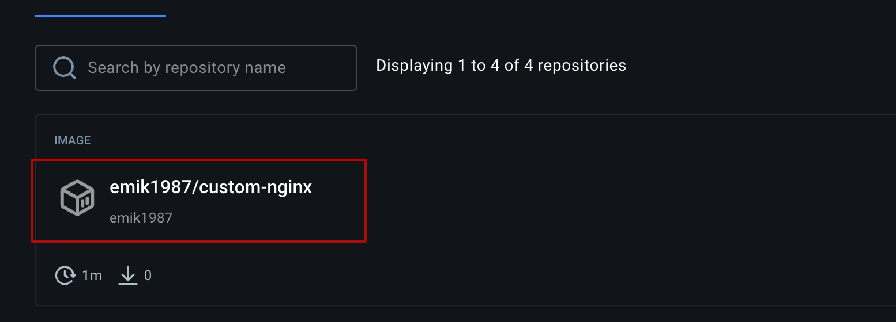

---

## Задача 2. Запуск и переименование контейнера

**Сценарий выполнения:**
*   Запущен контейнер из образа `custom-nginx:1.0.0` с именем `ФИО-custom-nginx-t2` в фоне с публикацией на порту `127.0.0.1:8080`.
*   Выполнено переименование контейнера в `custom-nginx-t2` без удаления.
*   Выполнена диагностическая команда.
*   Проверена доступность индекс-страницы через `curl`.

**Результат выполнения:**
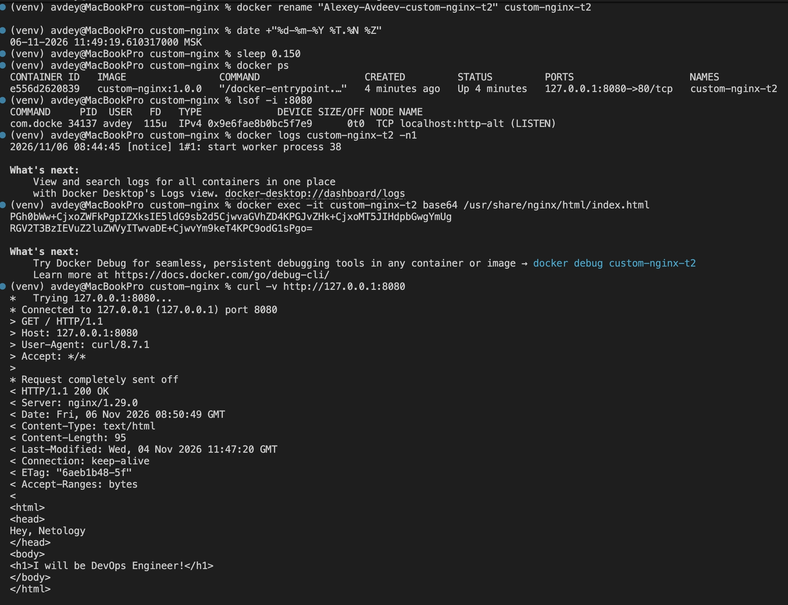

---

## Задача 3. Работа с контейнером, потоками и конфигурацией

**Сценарий выполнения:**
1.  Выполнено подключение к стандартному потоку ввода/вывода с помощью команды `docker attach custom-nginx-t2`.
2.  Нажата комбинация `Ctrl-C`.
3.  Выполнена команда `docker ps -a`.

**Объяснение, почему контейнер остановился:**
При использовании `docker attach` мы подключаемся к главному процессу контейнера (PID 1). В данном случае это процесс `nginx`. Комбинация `Ctrl-C` отправляет сигнал `SIGINT` главному процессу. Nginx аварийно завершает работу, а так как главный процесс завершился, Docker останавливает и сам контейнер.

**Сценарий выполнения (продолжение):**
*   Контейнер перезапущен.
*   Осуществлен вход в интерактивный терминал (`bash`).
*   Установлен редактор `vim`, изменен порт в конфигурации nginx с `80` на `81`.
*   Выполнена команда `nginx -s reload` и проверка `curl` на порты 80 и 81.
*   Выполнен выход из контейнера и проверка состояния портов.

**Объяснение сути возникшей проблемы:**
При создании контейнера был проброшен порт хоста `8080` на внутренний порт контейнера `80` (`-p 127.0.0.1:8080:80`). После изменения конфигурации nginx начал слушать порт `81` внутри контейнера. Так как порт 80 внутри контейнера больше никем не слушается, обращения с хост-машины на `127.0.0.1:8080` уходят в никуда (ошибка подключения), хотя сам контейнер продолжает работать и отвечает внутри на порт 81.

**Удаление запущенного контейнера:**
Контейнер удален одной командой с флагом `--force`: `docker rm -f custom-nginx-t2`.

**Результат выполнения:**
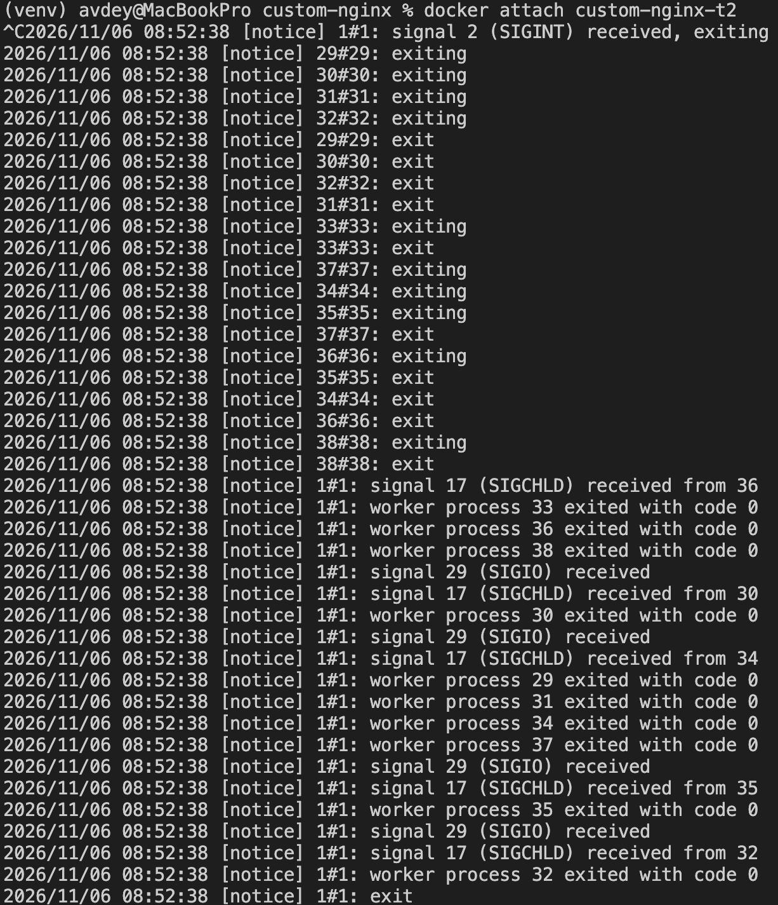
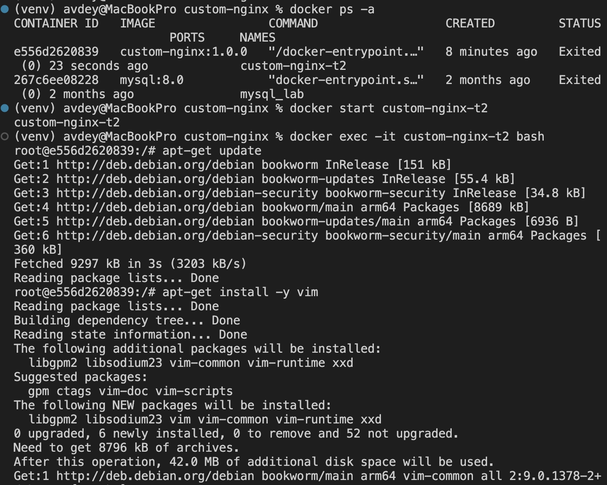
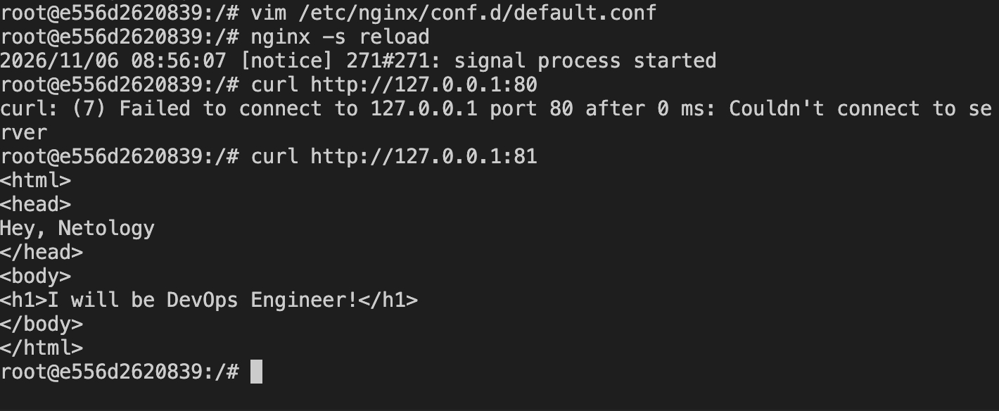
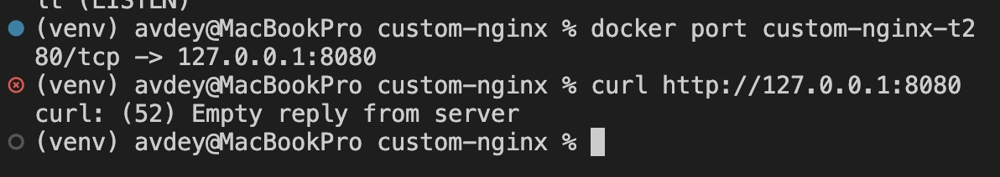
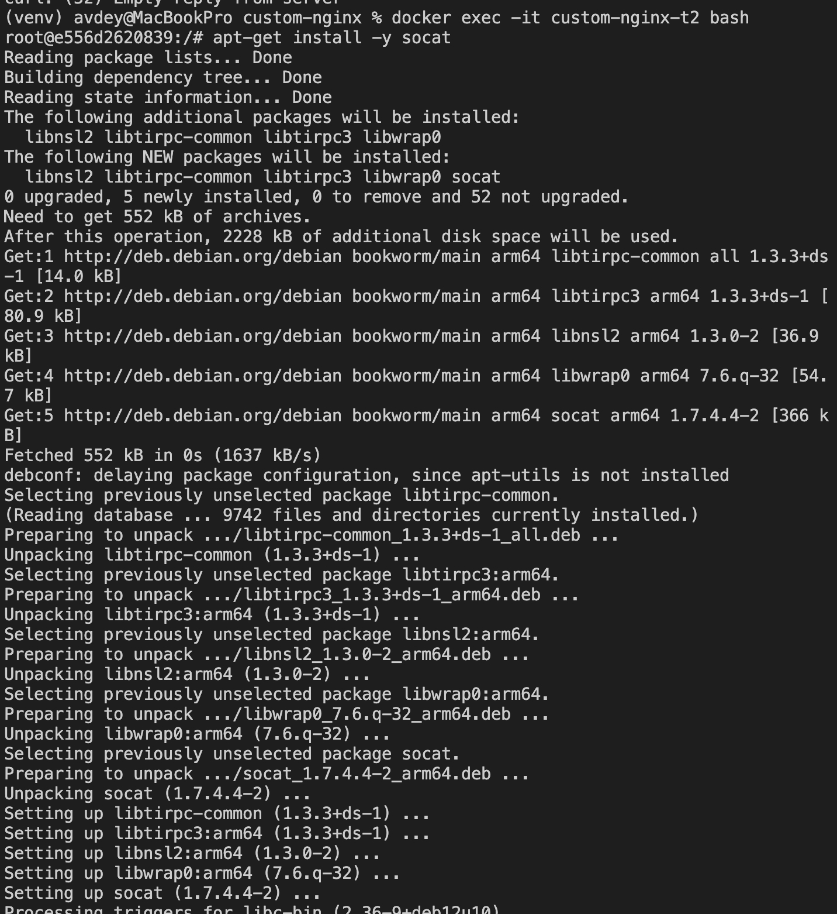
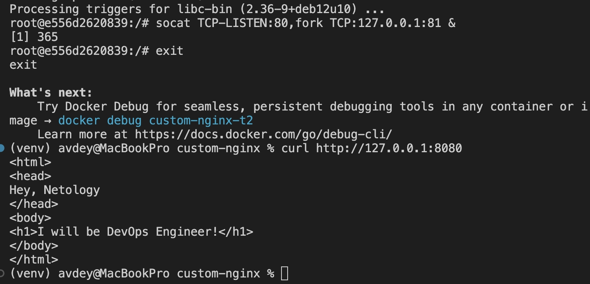

---

## Задача 4. Совместное использование томов (Volumes)

**Сценарий выполнения:**
*   Запущен контейнер `centos` в фоне с монтированием текущей директории `$(pwd)` в `/data` контейнера.
*   Запущен контейнер `debian` аналогичным образом.
*   Из первого контейнера (CentOS) создан файл в `/data`.
*   На хостовой машине создан еще один файл в текущей директории.
*   Из второго контейнера (Debian) выведен листинг и содержимое файлов в `/data`.

Оба контейнера используют одну и ту же директорию хоста, поэтому изменения, сделанные в одном контейнере или на хосте, сразу видны в другом.

**Результат выполнения:**
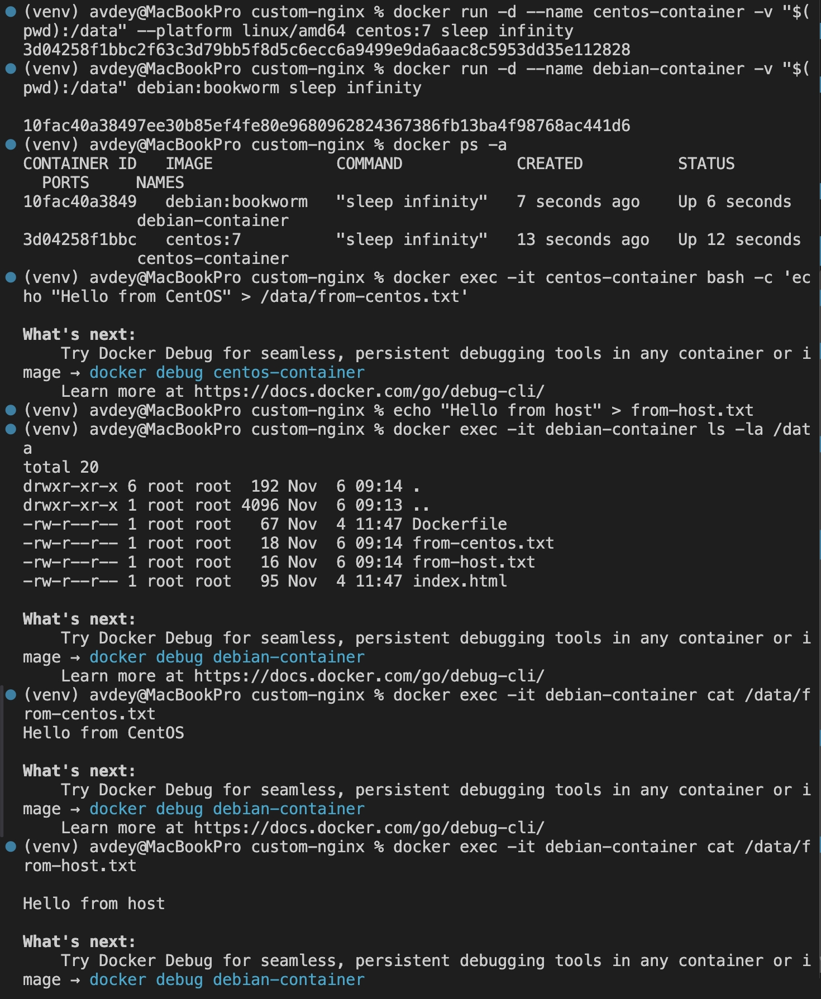

---

## Задача 5. Docker Compose, локальный Registry и Portainer

### 1. Какой файл был запущен и почему?
При выполнении `docker compose up -d` в директории с файлами `compose.yaml` и `docker-compose.yaml`, был запущен только **`compose.yaml`**.
Согласно документации Docker Compose, по умолчанию ищется файл с каноническим именем `compose.yaml` (или `compose.yml`). Файл `docker-compose.yaml` является устаревшим (legacy) именем и игнорируется, если в папке присутствует `compose.yaml`.

### 2. Объединение файлов
Для запуска обоих сервисов в `compose.yaml` был добавлен блок `include`, который подтягивает сервисы из второго файла:

**Итоговый файл `compose.yaml`:**
```yaml
include:
  - docker-compose.yaml

services:
  portainer:
    image: portainer/portainer-ce:latest
    ports:
      - "9000:9000"
      - "9443:9443"
    volumes:
      - /var/run/docker.sock:/var/run/docker.sock
```

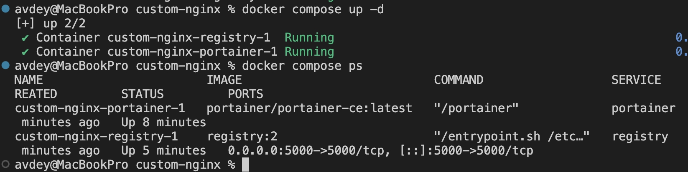
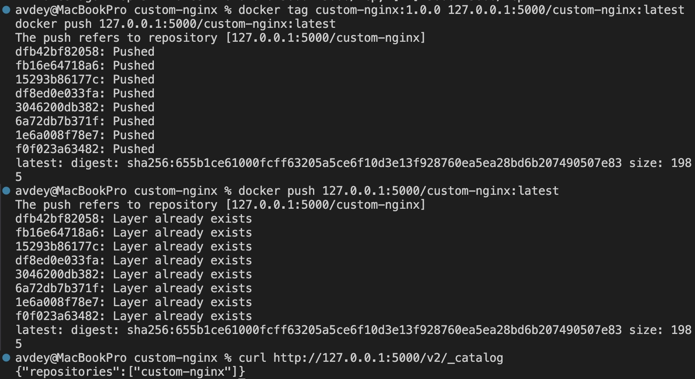

в macOS network_mode: host не пробрасывает порты на хост-машину, поэтому для проверки в браузере на Mac использовался временный маппинг портов

