**Ссылка на форк-репозиторий:** [https://github.com/Avdey87/shvirtd-example-python](https://github.com/Avdey87/shvirtd-example-python)

---

## 📌 Задача 1. Сборка приложения и Multistage

> **Условие:** Создайте файл `Dockerfile.python` на основе существующего Dockerfile. Используйте базовый образ `python:3.12-slim`, конструкцию `COPY . .`, создайте `.dockerignore` и используйте `CMD ["uvicorn", "main:app", "--host", "0.0.0.0", "--port", "5000"]`. Протестируйте сборку. Используйте multistage сборку.

**Выполнение:**
* Создан `Dockerfile.python` с использованием двух этапов (builder и финальный образ) для уменьшения размера.
* Создан `.dockerignore` для исключения кэша, виртуальных окружений и лишних файлов.
* Образ успешно собран, приложение запускается и слушает порт 5000. 
* *Примечание:* Ошибка подключения к MySQL на этом этапе ожидаема, так как БД еще не запущена.

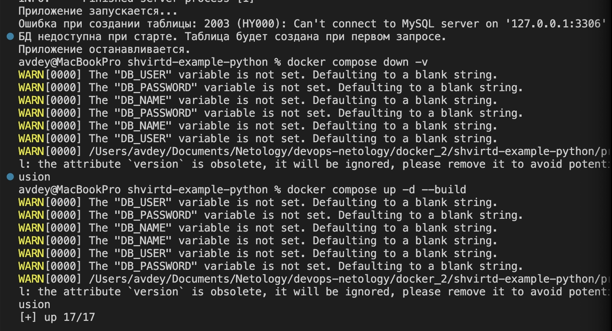

---

## 📌 Задача 3. Docker Compose и работа с БД

> **Условие:** Создайте `compose.yaml`, подключите `proxy.yaml` через `include`. Опишите сервисы `web` и `db` в bridge-сети `backend` с фиксированными IP (172.20.0.5 и 172.20.0.10). Используйте `.env` для секретов. Добейтесь ответа от `curl -L http://127.0.0.1:8090`. Подключитесь к БД и сделайте SQL-запрос.

**Выполнение:**
* Написан `compose.yaml` с использованием директивы `include` и пробросом портов.
* Сервисы запущены в изолированной сети `backend` со статическими IP.
* Переменные окружения проброшены из существующего `.env` файла.
* Команда `curl -L http://127.0.0.1:8090` успешно возвращает время и IP-адрес.
* Выполнен вход в контейнер MySQL и сделан SQL-запрос к таблице `requests`.

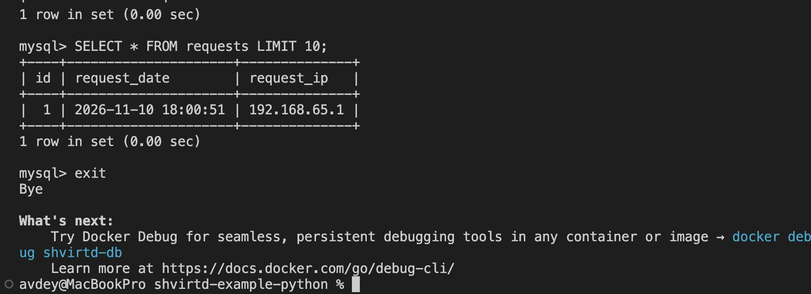

---

## 📌 Задача 4. Развертывание в Yandex Cloud

> **Условие:** Запустите ВМ в Yandex Cloud (2 Гб RAM). Установите Docker. Напишите bash-скрипт для скачивания форка в `/opt` и запуска проекта. Проверьте сервис через `check-host.net`. Повторите SQL-запрос.

**Выполнение:**
* Инфраструктура в Yandex Cloud развернута с помощью **Terraform** (создана ВМ, сеть, подсеть и security group с открытыми портами 22 и 8090).
* Написан bash-скрипт `deploy.sh`, который клонирует репозиторий в `/opt` и запускает `docker compose`.
* Сайт `check-host.net` подтвердил доступность сервиса по адресу `http://51.250.10.3:8090` из десятков стран мира (код `200 OK`).
* Выполнен повторный SQL-запрос на сервере. В таблице зафиксированы записи с внешних IP-адресов.

**Скриншоты выполнения:**

  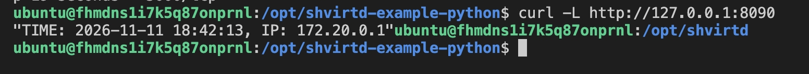
  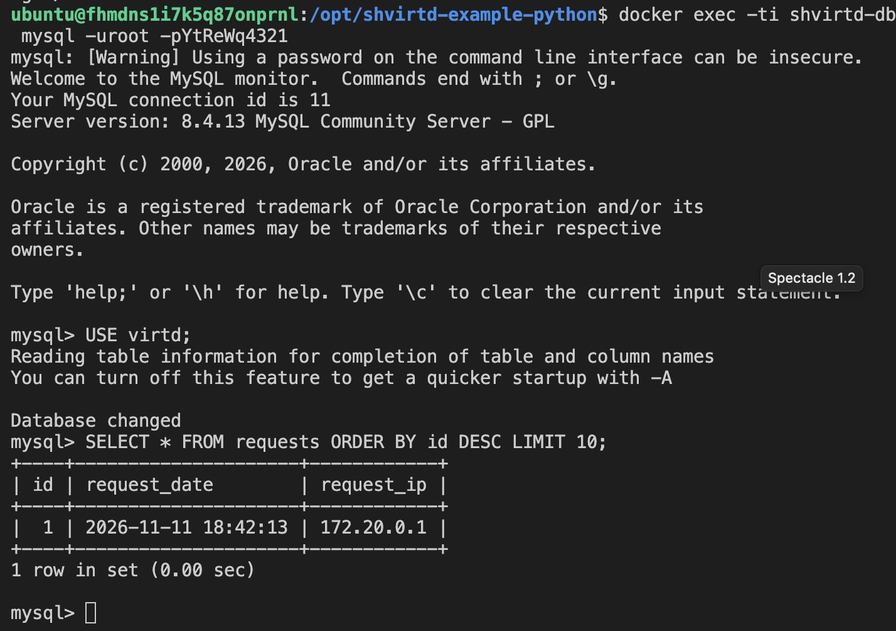

  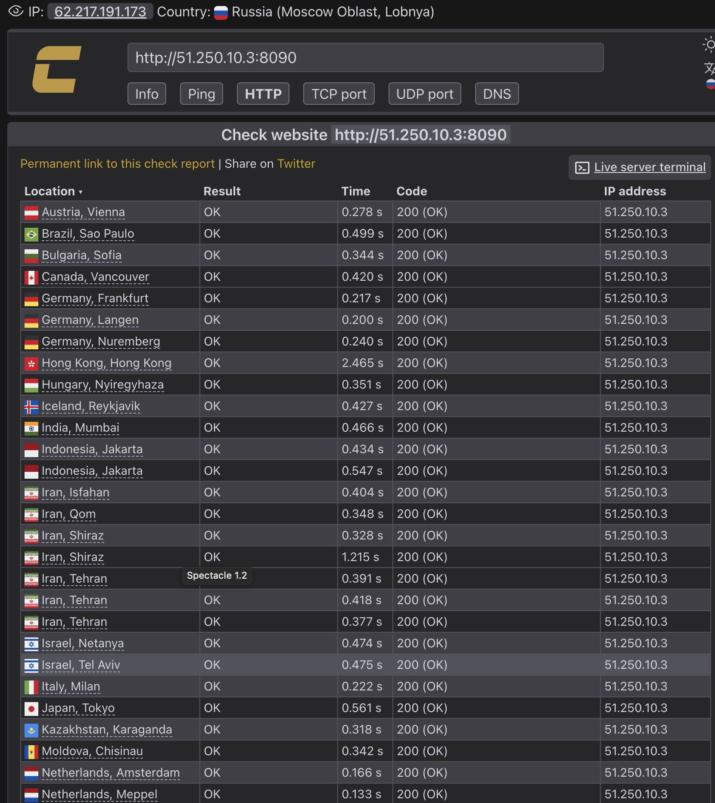
  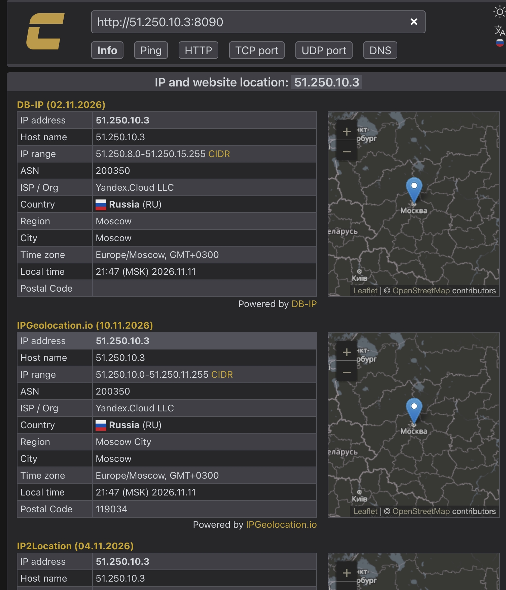

  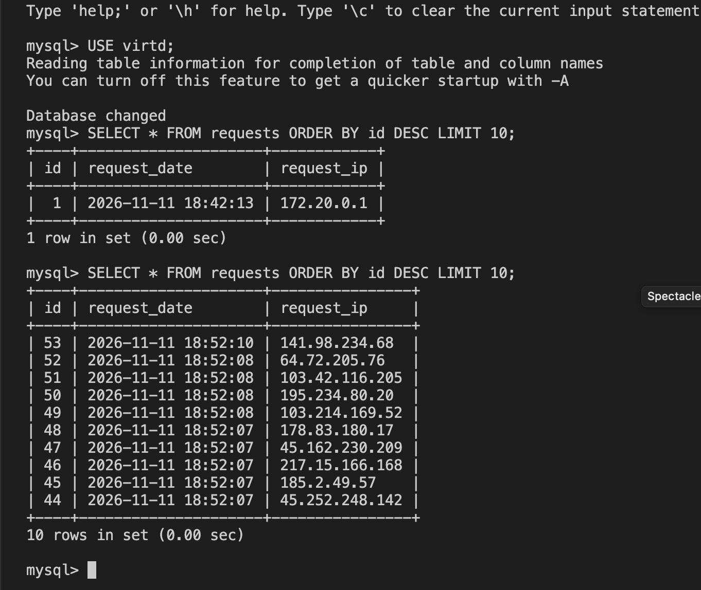

---

## 📌 Задача 6. Извлечение бинарного файла Terraform

> **Условие:** Скачайте docker образ `hashicorp/terraform:latest` и скопируйте бинарный файл `/bin/terraform` на свою локальную машину, используя `dive` и `docker save`. Предоставьте скриншоты действий.

**Выполнение:**
* Образ скачан и проанализирован с помощью утилиты `dive`.
* Образ сохранен в tar-архив с помощью `docker save`.
* Архив распакован, из слоев извлечен бинарный файл `/bin/terraform`.
* При попытке запуска на macOS возникает ошибка `exec format error`, так как бинарник собран под Linux (ELF). Файл успешно скопирован, его валидность подтверждена (размер и тип файла).

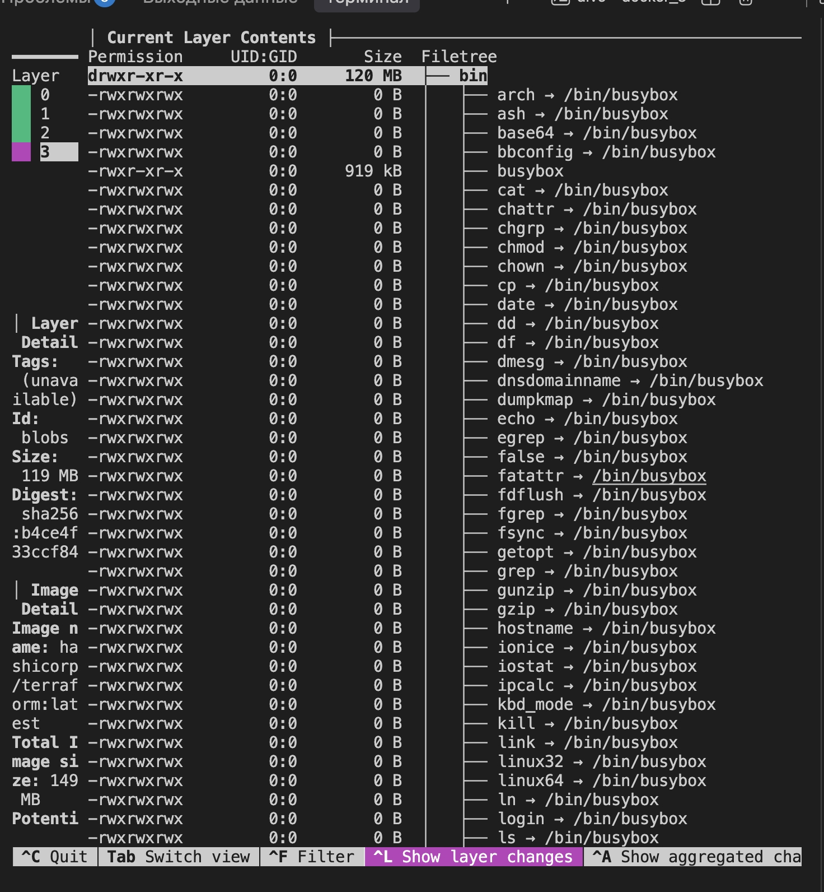
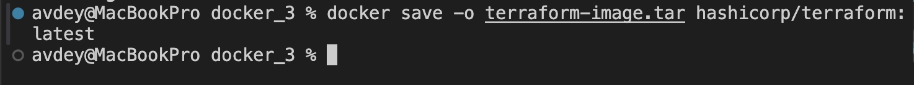
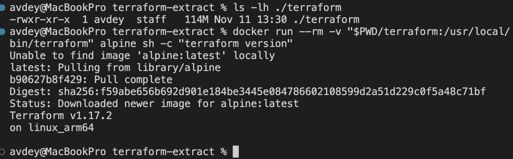
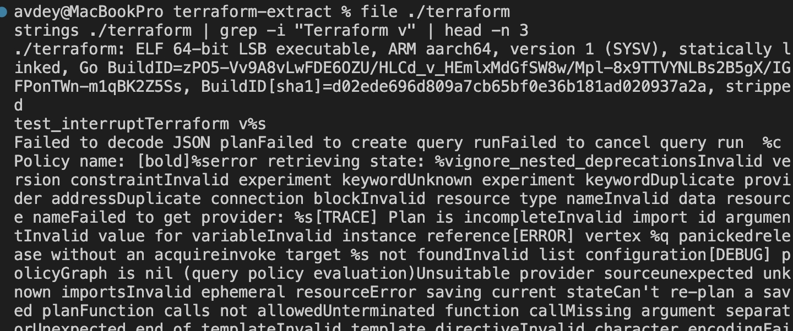

---
